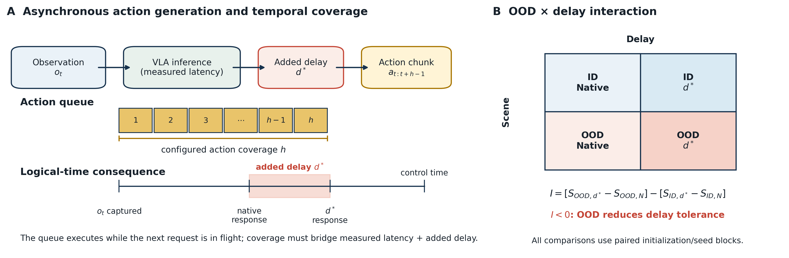
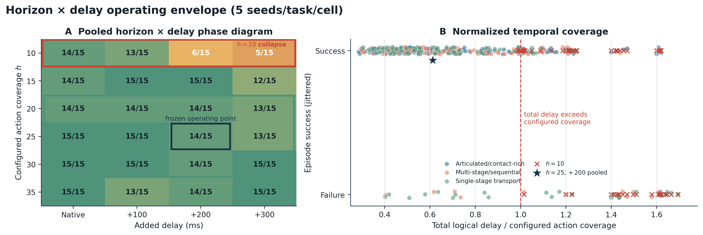
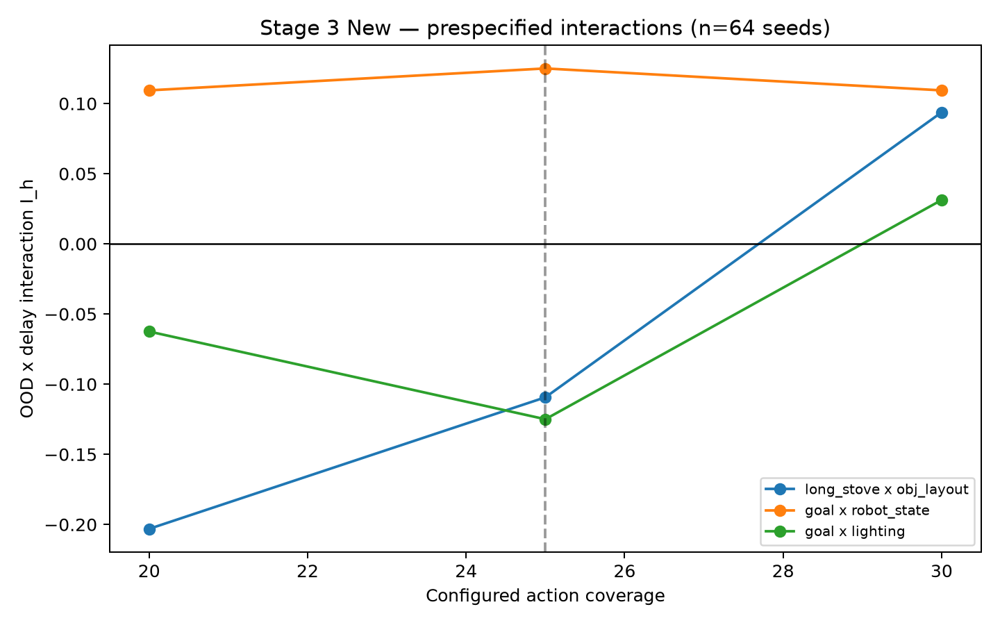
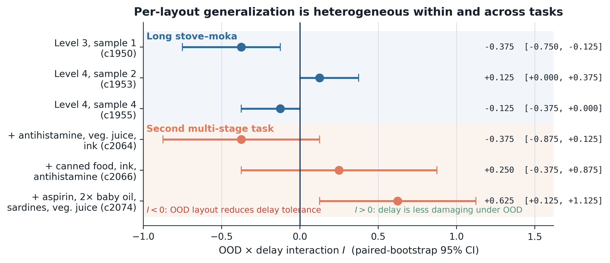

# When Delay Meets Distribution Shift: Evaluating Asynchronous Vision-Language-Action Policies

**Accepted to the NeurIPS 2026 RoboPAD workshop.** See the [official workshop listing](https://neurips.cc/virtual/2026/loc/paris/162917).

This repository contains the benchmark, experiment runners, analysis code, and
paper artifacts for studying how inference delay, temporal action coverage, and
distribution shift affect asynchronous vision-language-action (VLA) execution.

## Repository contents

- [`paper/`](paper/) — paper source, compiled PDF, figures, and paper-specific README.
- [`async_vla_benchmark/`](async_vla_benchmark/) — benchmark implementation, runners, validators, and analysis scripts.
- [`notebooks/`](notebooks/) — setup, experiment, validation, and figure-generation notebooks.
- [`docs/`](docs/) — experiment protocols, results ledger, reproducibility notes, and runbooks.
- [`DataArchive/`](DataArchive/) — selected tracked benchmark artifacts; the large 64-seed episode archive is intentionally kept outside Git.

## Reproduce the results

The final primary-policy experiment is the Stage 3 New high-power replication:
RTC execution, horizons \(h \in \{20,25,30\}\), native and +200 ms logical
delay, six frozen OOD task–perturbation candidates, and 64 seeds (`46..109`)
per cell. It produces 3,456 physical episode rows. The complete protocol is in
[`docs/STAGE_3_NEW_HIGH_POWER_REPLICATION.md`](docs/STAGE_3_NEW_HIGH_POWER_REPLICATION.md).

### 1. Provision a pinned GPU environment

Use one idle NVIDIA A100-SXM4-40GB. On Vast.ai, create a Hugging Face token,
export it, and run:

```bash
export HF_TOKEN='hf_...'
bash setup_vastai.sh 2>&1 | tee /workspace/setup_vastai.log
```

For a conventional cloud VM, use `setup_instance.sh` instead. These scripts
install the pinned LeRobot/LIBERO dependencies, download the assets and model,
and create the ID/OOD virtual environments.

### 2. Run the complete frozen experiment

The wrapper performs the preflight tests and then calls the benchmark scripts
in the required order. It creates the manifest, audits reset identities, runs a
throwaway smoke test, runs all ID and OOD episodes with resume support,
validates the physical rows, bootstraps the analysis, and packages the archive.

```bash
cd /workspace/async-vla-latency-bench
export HF_TOKEN='hf_...'
bash run_stage3_new.sh 2>&1 | tee -a /workspace/stage3_new/run.log
```

### 3. Scripts used, in order

The wrapper runs the following scripts. Each step writes durable outputs under
`/workspace/stage3_new/`, and the `--resume` flag makes interrupted episode
runs restart without duplicating valid rows.

1. `make_stage3_new_manifest` freezes the 3,456-row physical matrix with
   immutable benchmark, LeRobot, LIBERO-Plus, and model revisions. It is also
   called with `--smoke-seed 999 --smoke-horizon 25` to create the 18-episode
   preflight manifest.
2. `resolve_stage3_initializations` runs once for `--scene id` and once for
   `--scene ood`, recording reset fingerprints and checking that paired rows
   are repeatable.
3. `run_stage3_new` executes the smoke ID/OOD manifests, then the full 1,152
   ID and 2,304 OOD episodes. The OOD invocation uses the Xvfb/native-library
   environment prepared by `run_stage3_new.sh` when the host lacks EGL.
4. `validate_stage3_new` checks manifest cardinality, duplicate/missing rows,
   seed provenance, reset pairing, variant identity, and request timing fields.
5. `analyze_stage3_new` computes the cell summaries, paired contrasts, and
   10,000-replicate seed-block bootstrap intervals.

For an analysis-only rerun after the episode CSV already exists:

```bash
cd /workspace/async-vla-latency-bench
VENV_ID=/workspace/venv-stage1-id
$VENV_ID/bin/python -m async_vla_benchmark.scripts.analyze_stage3_new \
  --results /workspace/stage3_new/stage3_new_episode_results.csv \
  --manifest /workspace/stage3_new/stage3_new_manifest.csv \
  --output-dir /workspace/stage3_new/analysis \
  --bootstrap-replicates 10000 --bootstrap-seed 20260826
```

After the run, inspect the CSV and analysis outputs under
`/workspace/stage3_new/`. The archive is intentionally excluded from Git; see
[`docs/STAGE3_NEW_RESULTS_README.md`](docs/STAGE3_NEW_RESULTS_README.md) for
the expected layout. To build the paper locally:

```bash
cd paper
latexmk -pdf -interaction=nonstopmode neurips_2026_latest.tex
```

## Results and diagrams

The high-power replication does not support a universal claim that distribution
shift amplifies delay sensitivity. Effects are task- and horizon-dependent;
temporal action coverage and action freshness provide the clearest mechanism-
level explanation. The paper figures below summarize the setup, operating
envelope, replication contrasts, and layout generalization results.

### Experimental concept



### Horizon–delay operating envelope



### Held-out and cross-task replication



### Layout and task generalization


